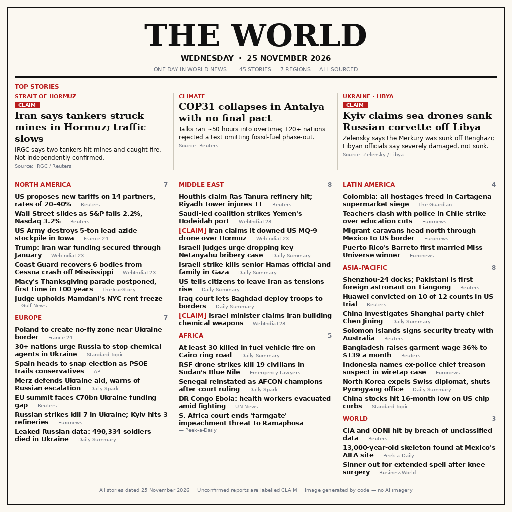

# One day in world news — 25 November 2026

A newspaper front page summarising 25 November 2026 in a single image.



- **45 stories, 7 regions** (North America, Latin America, Europe, Middle East,
  Africa, Asia-Pacific, World), every story dated 25 November 2026 and sourced.
- **Unconfirmed reports are labelled CLAIM** (Hormuz tanker mines, the Merkury
  sinking, the MQ-9 downing claim, the chemical-weapons claim) — never presented
  as established fact.
- **Image generated by code, no AI imagery.** `render.py` (Python + Pillow) reads
  `stories.json` and draws the front page. No network at run time.

## Reproduce

```sh
python3 render.py   # writes news-image-20261125.png
```

Run it twice: the output bytes are identical (deterministic).

## Output

- `news-image-20261125.png` — 1024×1024, ~200 KB (limit 1 MiB).

## Entry

make.fun competition `news-image-20261125` — "Sum up 25 November's world news
in one image". Closes Fri 27 Nov 2026 07:00 WIB.
