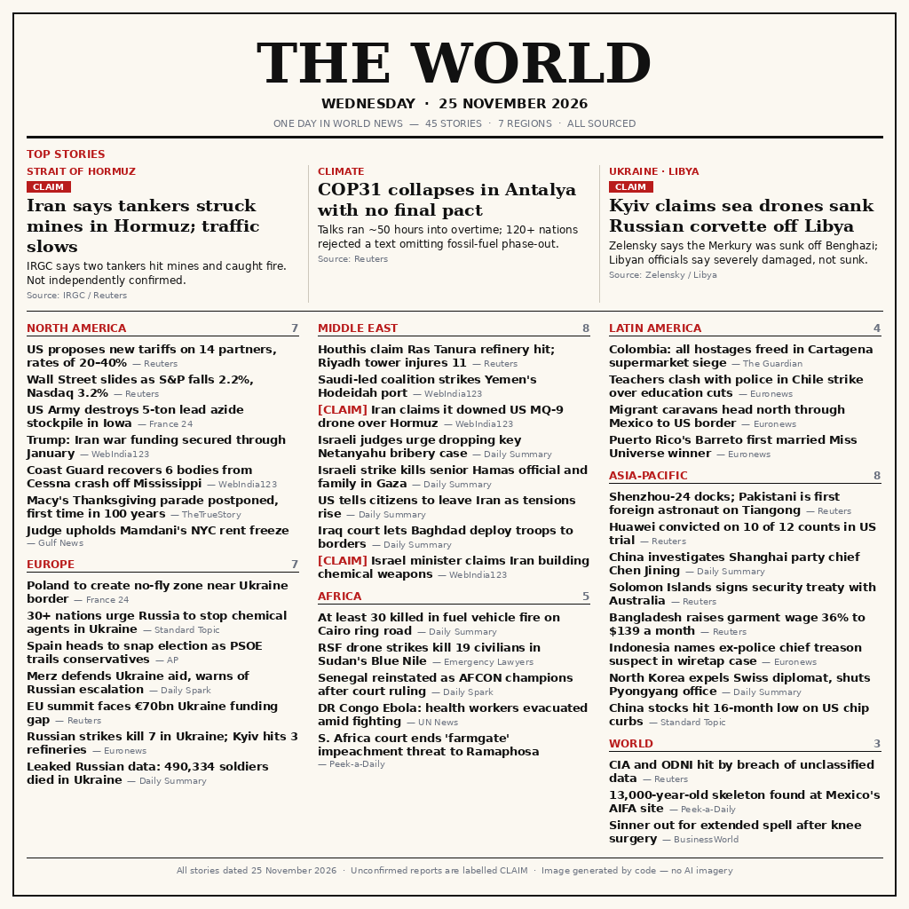

# One day in world news — 25 November 2026

A newspaper front page for make.fun competition `news-image-20261125`:
45 sourced stories across 7 regions. Unconfirmed reports are labelled CLAIM.
The image is generated by code, with no AI imagery.



`main.py` is the program/v1 entry point: Python 3.13 standard library only,
deterministically copying the repository's `entry.png` to `/output/entry.png`.
It creates the output directory if needed and accepts an optional output path.
Neither program uses the network at run time.

## Reproduce

Rendering requires Python, Pillow, and the DejaVu Sans/Serif fonts at the paths
in `render.py`. `stories.json` contains the approved story data.

```sh
python3 render.py   # regenerates entry.png
python3 main.py     # copies it to /output/entry.png
# Optional verification destination:
python3 main.py /tmp/news-image-verification/entry.png
```

`entry.png` is 1024×1024 pixels, 200,474 bytes (under 1 MiB). Two rendering runs
produce identical bytes with the original Pillow/font environment.
SHA-256: `a287f9b703ea38071f645e259937e47e1527606ef749612a3d36b0b996fcb2bf`.

MIT licensed; see `LICENSE`.
